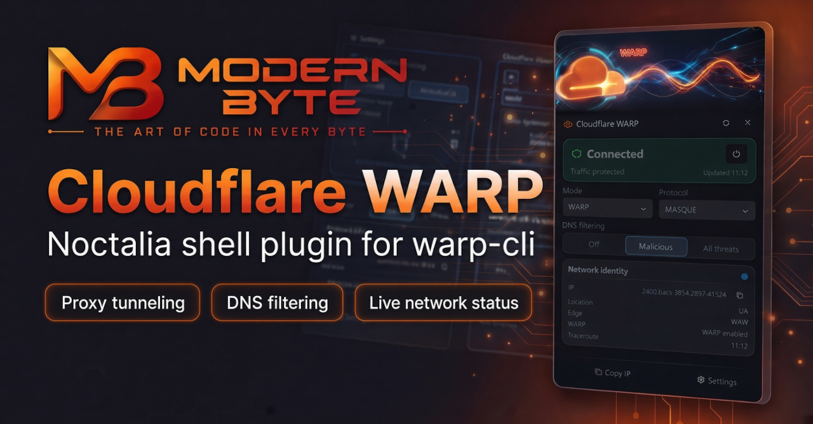

# Cloudflare WARP для Noctalia

**[English](README.md) · Русский**

Плагин для рабочего стола [Noctalia](https://github.com/noctalia-dev), который выводит
Cloudflare WARP туда, куда вы и так смотрите: значок состояния в панели, плиток
переключения в Control Center и полноценная панель управления. Проверяйте соединение,
включайте и выключайте WARP, меняйте режим работы и DNS-фильтрацию, смотрите свой
текущий публичный IP — не открывая терминал.

Автор: **Modern Byte**. Лицензия — MIT (см. [LICENSE](LICENSE)).



---

## Что нужно установить сначала

Плагин — это удобный интерфейс к официальной программе Cloudflare WARP, а не её
замена. Перед установкой:

1. **Установите клиент WARP.** Он даёт команду `warp-cli` и фоновую службу `warp-svc`.
   На большинстве систем:
   ```sh
   # Debian / Ubuntu
   sudo apt install cloudflare-warp
   ```
   (Другие платформы — см. официальное руководство Cloudflare по установке WARP.)
2. **Зарегистрируйтесь один раз.** Запустите WARP и привяжите устройство к аккаунту:
   ```sh
   warp-cli registration new
   ```
   В панели плагина есть кнопка **Зарегистрироваться**, которая проведёт вас через этот шаг.
3. **Примите условия использования** при первом запуске `warp-cli`.

Если WARP не установлен или служба остановлена, плагин покажет понятное
предупреждение и не упадёт — см. [Устранение проблем](#устранение-проблем).

## Установка плагина

Noctalia загружает плагин из его папки с исходниками.

1. Скачайте или клонируйте этот репозиторий, например в `~/plugins/cloudflare-warp`.
2. Укажите Noctalia путь и включите плагин:
   ```sh
   noctalia msg plugins source add cloudflare-warp path ~/plugins/cloudflare-warp
   noctalia msg plugins enable ModernByte/cloudflare-warp
   ```
   (Источник можно добавить и плагин включить через Настройки → Плагины Noctalia.)

Готово — значок в панели появится сразу.

## Как пользоваться

**Значок в панели**
- **Левая кнопка** открывает панель управления.
- **Правая кнопка** включает или выключает WARP.
- Цвет значка показывает состояние: подключено, отключено, подключение,
  предупреждение или ошибка.
- При наведении появляется подсказка со статусом, режимом, DNS-фильтрацией,
  протоколом и IP.

**Плитка Control Center**
- Клик переключает туннель; правый клик обновляет состояние.

**Панель управления** (из значка в панели)
- Большая карточка статуса с кнопкой питания.
- Анимированный баннер, который наполняется цветом при подключении и пока WARP активен.
- Выбор **режима** и **протокола туннеля**, **DNS-фильтрация** (Выкл / Вредоносное / Полная)
  и сведения об аккаунте.
- Карточка сетевого идентитета: публичный IP, местоположение и использует ли трафик WARP.
- Действия **Зарегистрироваться**, **Обновить** и **Скопировать IP**.

Панель доступна на английском и русском языках — по языку Noctalia.

## Настройки

Откройте Настройки Noctalia и найдите **Cloudflare WARP**.

| Настройка | По умолчанию | Назначение |
|---|---|---|
| Интервал опроса | 3000 мс | Как часто плагин проверяет реальное состояние WARP (1000–60000 мс). Панель остаётся актуальной, даже если WARP переключили в терминале или соединение оборвалось. |
| Уведомлять об изменении | вкл | Уведомление при подключении и отключении WARP. |
| Уведомлять об ошибке | вкл | Уведомление, когда что-то пошло не так (WARP не установлен, служба остановлена, команда не выполнилась). |
| Авто-трассировка | вкл | Периодически узнавать ваш публичный сетевой идентитет. |
| Интервал трассировки | 60 с | Как часто обновлять эти данные (15–3600 с). Видно только при включённой авто-трассировке. |
| Показывать текст в панели | вкл | Показывать короткое слово статуса рядом со значком. |
| Компактный режим | выкл | Только значок — для узких панелей. |

## Как это устроено (архитектура)

Плагин — это одна фоновая **служба** и три тонких интерфейсных элемента без привилегий.
Служба — единственная, кто работает с системой и сетью:

```
        ┌─────────────────────────────────────────────┐
        │                  service                      │
        │  опрашивает warp-cli, хранит единый статус    │
        └───────────────┬─────────────────────────────┘
                        │  публикует статус · принимает команды
                 ┌──────┴───────┐
                 │  state store │   warp.status / warp.command
                 └──────┬───────┘
        ┌───────────────┼───────────────┐
        ▼               ▼               ▼
     widget         shortcut          panel
  (значок в баре)    (Control Center)   (панель управления)
```

- **Служба** по таймеру запускает `warp-cli`, превращает вывод в чистый статус и
  записывает его в общее хранилище состояния. Когда вы что-то нажимаете, элементы
  интерфейса только отправляют команду — выполняет её служба. Больше командную строку
  никто не трогает.
- **Значок**, **плитка** и **панель** лишь читают статус и пишут команды: без сети,
  без командной строки, без прав суперпользователя.
- Состояние WARP может меняться само (обрыв соединения, переключение в терминале).
  Опрос по таймеру перечитывает реальное состояние каждые несколько секунд, поэтому
  панель всегда отражает фактическое положение дел.
- Каналы состояния общие, поэтому держите включённым только **один** плагин WARP —
  выключите другие плагины-переключатели WARP перед включением этого.

### Что запускается и куда идут сетевые запросы

- Всё управление WARP идёт через локальную команду `warp-cli`, всегда от имени вашего
  обычного пользователя. Плагин **никогда** не использует `sudo` и не запускает ничего
  от другого пользователя.
- Единственный сетевой запрос — необязательная проверка публичного идентитета на
  `https://www.cloudflare.com/cdn-cgi/trace`: Cloudflare отвечает вашим исходящим IP,
  местоположением и статусом WARP — то же самое показывает любой визит этого адреса в
  браузере. Чтобы полностью отключить запросы, выключите **Авто-трассировку** в настройках.
- Плагин не читает и не хранит аккаунты, ключи и учётные данные.

## Дополнительно: управление из скриптов

Те же действия, что и в панели, доступны через шину сообщений плагинов Noctalia —
удобно для горячих клавиш и скриптов:

```sh
noctalia msg plugin ModernByte/cloudflare-warp:service all toggle
noctalia msg plugin ModernByte/cloudflare-warp:service all connect
noctalia msg plugin ModernByte/cloudflare-warp:service all disconnect
noctalia msg plugin ModernByte/cloudflare-warp:service all refresh
```

## Устранение проблем

| Панель показывает | Что это значит | Что делать |
|---|---|---|
| «Недоступен» / статус без WARP | `warp-cli` не найден в PATH | Установите пакет Cloudflare WARP, затем нажмите «Обновить». |
| Предупреждение об остановленной службе | Фоновая служба `warp-svc` не запущена | Запустите её: `sudo systemctl start warp-svc` (в терминале), затем «Обновить». |
| «Не зарегистрирован» | У WARP нет аккаунта на устройстве | Нажмите **Зарегистрироваться** в панели или выполните `warp-cli registration new`. |
| Красная ошибка после действия | Команда не выполнилась или был тайм-аут | Причина — в подсказке и на панели; нажмите «Обновить». |
| Выбор режима неактивен | Режим заблокирован настройками WARP | Разблокируйте в самой конфигурации WARP — селектор включится сам. |

Если WARP не установлен или служба лежит, плагин живёт дальше и показывает
предупреждение — он не падает и не исчезает.

## Документация

В [вики](https://github.com/ModernByte/cloudflare-warp/wiki) — полная документация
на русском и английском: установка, архитектура, IPC-справочник и устранение проблем.

## Известные ограничения

- **Значение DNS-фильтрации** через `warp-cli` только записывается, но не читается,
  поэтому после перезагрузки панель показывает значение по умолчанию (Вредоносное),
  пока вы не смените его заново в текущей сессии.
- **Плитка Control Center** использует текстовую/символьную подпись (платформа не
  принимает туда картинку); значок в панели — с полноцветными иконками.
- Держите включённым только один плагин WARP (общие каналы состояния).

## Лицензия

Copyright (c) 2026 Modern Byte, лицензия **MIT**.

«Cloudflare» и «WARP» — товарные знаки Cloudflare, Inc. Это самостоятельный плагин;
он не связан с Cloudflare и не поддерживается ею.
